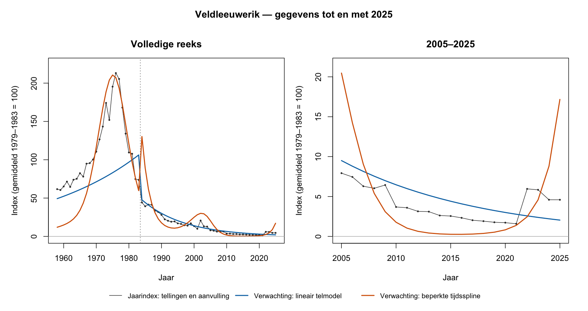
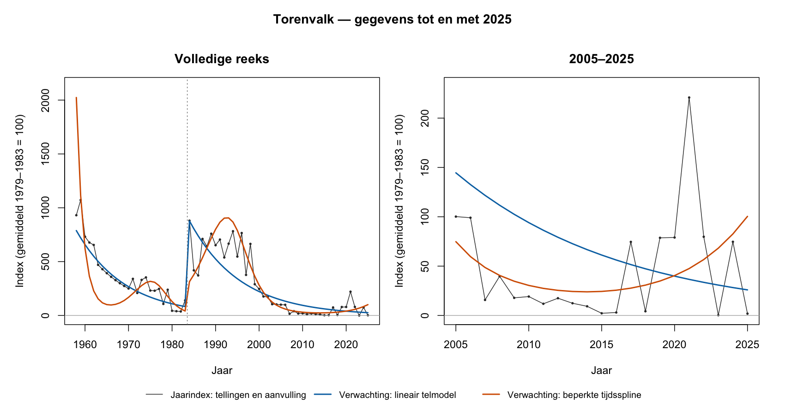
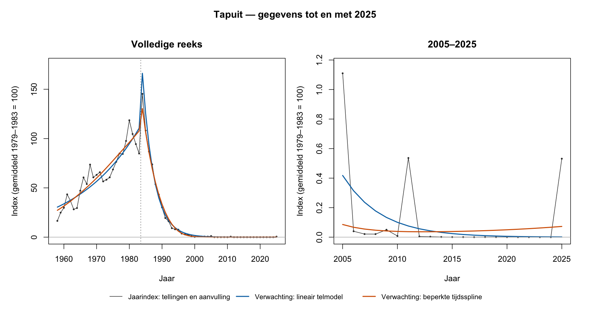
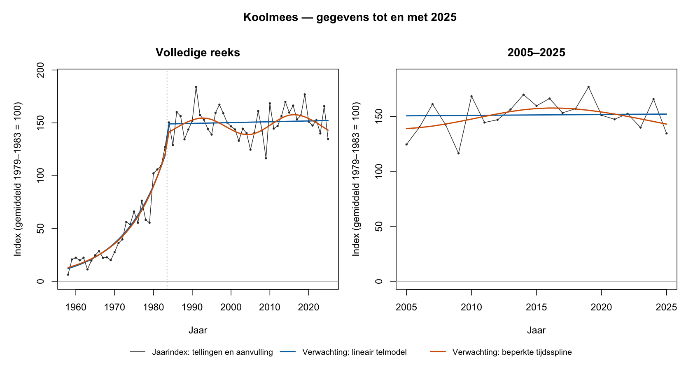

# Uitvoering nuljarenbeleid met gegevens tot en met 2025

De beveiliging is uitgevoerd. De 45 betrokken periodetrends voor 40 soorten
krijgen de status `nuljaartotaal_herbeoordelen`. Hun helling, standaardfout,
interval, p-waarde en trendklasse zijn leeg. De tellingen, jaarindices,
modelkeuzen, brugfactoren en soortselecties zijn behouden.

De gerichte vergelijking is eveneens uitgevoerd: Veldleeuwerik,
Torenvalk, Tapuit en Koolmees, met de bestaande bron 1958–2025 en dezelfde
50 kavelnetwerktrekkingen. De telmodellen kunnen meer trekkingen verwerken,
maar zijn inhoudelijk niet onderling uitwisselbaar. Er is daarom geen
algemene vervanger ingesteld die op grond van berekenbaarheid alleen
voor alle soorten één lang trendpercentage afdwingt.

## Wat is daadwerkelijk aangepast

De gedeelde `trim_overall_contract()` blokkeert de impliciete nul→één-
vervanging van rtrim 2.3.1. Een positieve waarde onder de interne grens
1e-6 krijgt ook een concrete herbeoordelingsstatus. Ontbrekende,
niet-eindige, negatieve of onvolledige totaalvectoren krijgen geen formele
inferentie. De contractkolommen en versie v2 blijven gelijk; statuswaarden
zijn uitgebreid. Een geslaagd telmodel blijft als model behouden.

Alle 228 geslaagde historische periodemodellen zijn opnieuw door het
contract beoordeeld: 183 behouden formele inferentie, 45 zijn geblokkeerd
(21 in 1958–1983 en 24 in 1984–2025). In de hoofdtrendtabel zijn die
45 perioden gecorrigeerd; in de overlappende tabel met beide bruikbare
modelperioden 25. Dit zijn geen 70 verschillende perioden. De twee tabellen
heten `soorten_trendoverzicht.csv` en
`soorten_trendoverzicht_bruikbare_tijdreeks.csv`.

De oorspronkelijke waarden zijn herleidbaar via de vorige Git-versie en
`status_changes.csv`. De beide jaarindexbestanden, het modelstatusbestand
en de brugfactorentabel hebben exact dezelfde SHA256 als vóór deze stap.
De niet-betrokken inferentievelden zijn gelijk gebleven. De bestaande
156-soortenpopulatie en 93-soortenselectie op twee modelperioden zijn niet
verkleind. Historische pilotresultaten van 2 november blijven als
methodebewijs bewaard; de nieuwe enginehash verhindert dat die bronbundle
stilzwijgend voor een nieuwe berekening wordt hergebruikt.

Dit is werk op de bootstrapontwikkelbranch. Er is geen wijziging in MySQL,
nieuwe dump/cache, invoer van 2026, herbouw van het dashboard of
VPS-publicatie uitgevoerd. Andere historische analyses, zoals de Sandra-
uitvoer 1997–2022, zijn niet opnieuw gegenereerd; bij een nieuwe berekening
gebruiken zij wel dezelfde beschermde contractfunctie.

## Vier rekenwijzen vergeleken

1. De bestaande loglineaire samenvatting van de jaarindex.
2. Een quasi-Poisson-samenvatting op het niveau van diezelfde jaarindex.
   Deze kan nulindices meenemen, maar verandert de samenvattende maat.
3. Een direct telmodel per periode met een kaveleffect en één lineair
   tijdseffect op logschaal.
4. Datzelfde telmodel met een beperkte tijdsspline, k=5 en REML.
   k=3 en k=7 zijn alleen op de oorspronkelijke bron als gevoeligheid
   vergeleken, niet gebruikt om achteraf de gunstigste curve te kiezen.

De telmodellen gebruiken de oppervlaktegecorrigeerde tellingen, inclusief
nullen. Quasi-Poisson laat de bestaande fracties toe. Het zijn
verwachtingscurven: een positieve verwachting betekent niet dat in een
nuljaar alsnog vogels zijn waargenomen. Niet-getelde jaren blijven
voorspelling, geen getelde nul. Kalenderjaren en de kavelnetwerktrekking
blijven gelijk aan de pilot. Dezelfde empirische vijfjaarskalibratie
1979–1983/1986–1990 wordt gebruikt. Elke modelcurve krijgt de daarbij
passende ankerschaal; de empirische niveauverhouding wordt niet aangepast
om een gunstiger resultaat te krijgen. De jaren 1984–1985 blijven in het
periodemodel, maar niet in de kalibratie.

### Oorspronkelijke lange helling in procenten per jaar

Dit zijn beschrijvende puntschattingen uit de oorspronkelijke bron
1958–2025, geen nieuw vrijgegeven formele trenduitkomsten.

| Soort | Log-jaarindex | Quasi-jaarindex | Lineair telmodel | Telmodel met tijdsspline |
|---|---:|---:|---:|---:|
| Veldleeuwerik | −6,56 | −4,57 | −5,62 | −6,62 |
| Torenvalk | −5,73 | −2,75 | −3,56 | −3,29 |
| Tapuit | −18,46 | −4,13 | −15,14 | −13,56 |
| Koolmees | +3,55 | +2,29 | +3,46 | +3,41 |

### Berekenbare uitkomsten binnen dezelfde 50 trekkingen

| Soort | Log-jaarindex | Quasi-jaarindex | Lineair telmodel | Telmodel met tijdsspline |
|---|---:|---:|---:|---:|
| Veldleeuwerik | 31/50 | 50/50 | 50/50 | 50/50 |
| Torenvalk | 10/50 | 49/50 | 49/50 | 49/50 |
| Tapuit | 29/50 | 50/50 | 50/50 | 48/50 |
| Koolmees | 50/50 | 50/50 | 50/50 | 50/50 |

Bij Tapuit bereikten twee postmodellen met spline (replicaties 17 en 34)
geen volledige optimalisatie. Die zijn niet als geslaagd geteld.
De convergentiecontrole toetst zowel de interne fit als de optimalisatie
van de gladheid. Ook onder de 48 geaccepteerde splineberekeningen is de
helling gevoelig: het bereik loopt van −50,49 tot −10,17% per jaar. Dat
is diagnostische spreiding, geen 95%-interval.

Zelfs voor Koolmees, waar alle vier berekeningen slagen, verschilt de
quasi-indexhelling van de andere drie. Deze rekenwijze doet dus meer dan
alleen nuljaren verwerken. De lineaire telmodellen kunnen een gebogen
populatieverloop niet volledig volgen. De spline kan bochten beschrijven,
maar vooral bij de schaarse soorten hangt het verloop ook van de gekozen
flexibiliteit en gegevenssteun af. Dat maakt geen van deze curven een
automatische algemene vervanger.

## Controle met achtergehouden jaarblokken

De oorspronkelijke tellingen zijn per periode in vaste blokken van drie
jaar verdeeld, over vijf testgroepen. Bij elk model wordt één groep
achtergehouden. Alleen een volledig getrainde en geconvergeerde voorspelling
voor alle testcellen telt als volledige testgroep. Als een testkavel in de
training geen positieve waarneming heeft, is dat een grensprobleem voor
het gekozen vaste kaveleffect. Die testgroep wordt expliciet onvolledig
gemeld, niet weggelaten om een gunstig gemiddelde te krijgen.

| Soort | Volledige testgroepen 1958–1983 | Volledige testgroepen 1984–2025 |
|---|---:|---:|
| Veldleeuwerik | 3/5 | 1/5 |
| Torenvalk | 2/5 | 0/5 |
| Tapuit | 4/5 | 2/5 |
| Koolmees | 3/5 | 4/5 |

Deze dekking is voor beide tijdsvormen gelijk. Geen van de acht
soort-perioden heeft volledige dekking. Daarom is geen algemene
voorspelrangorde toegekend. Dit bewijst niet dat er geen informatie in de
nulcellen zit of dat de tellingen onbruikbaar zijn; het begrenst deze
validatie van een telmodel met vaste kaveleffecten. De afzonderlijke
verliezen staan in `cv.csv`; de geaggregeerde score blijft bij onvolledige
dekking leeg. Er zijn geen formele Poisson-p-waarden of AIC-rangordes
gebruikt voor deze quasi-modellen.

## Verloop per soort

Alle figuren zijn voor de vormvergelijking op hetzelfde anker gezet:
gemiddeld 1979–1983 = 100. Deze herijking verandert geen helling. Links
staat het gehele beschikbare verloop; rechts 2005–2025. De zwarte lijn
is de jaarindex met tellingen en aanvulling, de gekleurde lijnen zijn
modelverwachtingen. Dat onderscheid blijft ook in de CSV-bestanden staan.

## Wat vóór 2026 klaar is en wat overblijft

De nulbeveiliging, historische statuscorrectie, gerichte modelvergelijking,
controles en herkomstregistratie zijn uitgevoerd. Echte nullen blijven
in de jaarindex. Een overall-percentage wordt niet als formeel geleverd
wanneer de huidige rekenregel een nul vervangt. Er is geen stille
soortenfilter of geforceerde positieve jaarindex ingevoerd.

De vergelijking geeft geen basis om nu één nieuwe lange-trendmaat voor
alle soorten vrij te geven. De nulvriendelijke indexsamenvatting verandert
de betekenis; de onderzochte telmodellen zijn bij de schaarse soorten nog
niet voldoende onafhankelijk gevalideerd. Daarom is een algemene
500/2.000-run niet gestart. Een grotere run lost deze methodische keuze
niet op. Voor soorten zonder verdedigbare lange helling blijven het
jaarverloop en de tellingen de inhoudelijke basis.

Na inhoudelijke validatie en invoer van 2026 volgen een nieuwe gevalideerde
bronbasis en herijking van soort-, periode- en kaveldekking. De beschermde
contractfunctie wordt dan automatisch opnieuw toegepast; de aantallen
45 en 183 worden niet op 2026 overgenomen. Welke resultaatstypen een
formeel interval kunnen krijgen, wordt daarna per soort beoordeeld.
De keuze van een algemene lange-trendmaat blijft een methodische vraag,
geen reden om 2026-cijfers vóór validatie in te voeren.

## Bestanden en reproduceerbaarheid

`contracts.csv` bevat alle 228 actuele periodecontracten.
`status_changes.csv` bewaart de oude helling en nieuwe status per correctie.
`summaries.csv`, `curves.csv`, `model_diagnostics.csv`, `cv.csv`,
`cvsummary.csv` en `sensitivity.csv` bevatten de vier-soortenvergelijking.
`manifest.json` legt bron, context, software en analysecode vast.
`unchanged_source_outputs.json` bevat de onveranderde bestandshashes.
Uitgebreide replicatiestaten en de oude twee trendtabellen staan uitsluitend
in de lokale, genegeerde uitvoermap.

Uitvoering: `R/audit_trim_main_index_zeros.R REPO PILOTRUN UITVOER --refresh-status`
en `R/compare_trim_zero_count_models.R REPO PILOTRUN VERGELIJKING`.
R 4.5.3, rtrim 2.3.1 en mgcv 1.9.4; één worker op de lokale iMac.
Het bijgewerkte auditprogramma ververst alleen met de expliciete optie
`--refresh-status`; het is geen algemene export of dashboardgenerator.

Modelreferenties: [rtrim FAQ](https://cran.r-universe.dev/rtrim/doc/FAQ.html)
en de [officiële mgcv-documentatie](https://www.stat.ethz.ch/R-manual/R-devel/library/mgcv/html/gam.html).

## Eindcontrole en beperking bij hergebruik

Onafhankelijke review bevestigt de 45/25 periodecorrecties, 228/183/45-
contracten, ongewijzigde bronuitvoer en de 816 schattingen en 816
modeldiagnostiekregels. De kopieën in dit rapport zijn bytegelijk aan de
definitieve berekeningsuitvoer. Alle 59 Wordpagina's zijn afzonderlijk
visueel gecontroleerd.

Het correctiehulpmiddel weigert een afwijkende soortselectie of een
2026-periodelabel vóór schrijven. Bij later opnieuw gemaakte tabellen over
precies dezelfde jaren is daarnaast een nieuwe broncontrole nodig: de
hulproute bevat daarvoor nog geen volledige inhoudsfingerprint. De huidige
correctie is rechtstreeks en onafhankelijk tegen de Git-basis gecontroleerd.
De uitvoeringsafwegingen staan in de bijbehorende planregistratie.
